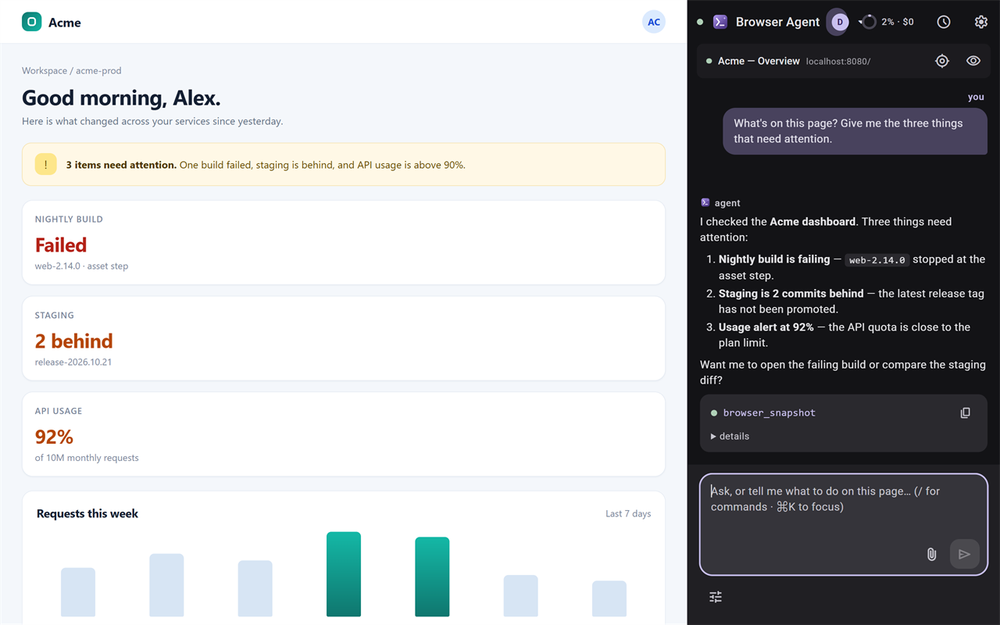

# Browser Agent for opencode

A Chrome side panel that connects your browser to a real [opencode](https://opencode.ai) V2 agent running on your computer. Ask it to look at the page, click, type, navigate, read the console, take a screenshot, or run a scheduled browser task — while you keep browsing in the same tabs.

This is an independent community project. It is **not affiliated with, endorsed by, or sponsored by** Anomaly Innovations, Inc., the opencode project, or Google. opencode and Chrome are trademarks of their respective owners.

[](store/screenshots/01-chat.png)

## What it does

| Tool | What it does |
| --- | --- |
| `browser_snapshot` | URL, title, console tail, and an indented element tree with `[ref=eN]` handles |
| `browser_click` / `browser_hover` | Click or hover by ref, CSS selector, or visible text |
| `browser_type` | Type into inputs, textareas, and contenteditable elements |
| `browser_press` | Send keyboard keys (Enter, Tab, arrows, …) |
| `browser_select` | Choose an option in a `<select>` |
| `browser_scroll` | Scroll the page or bring an element into view |
| `browser_wait_for` | Wait for text, a selector, or a ref to appear |
| `browser_navigate` | Open a URL, or go back / forward / reload |
| `browser_tabs` | List, create, close, activate, or group tabs |
| `browser_upload` | Attach local files to a file input |
| `browser_downloads` | List recent downloads and their local paths |
| `browser_console` | Read console output, clear it, or evaluate JavaScript through Chrome's debugger API |
| `browser_screenshot` | Save a PNG screenshot to `.opencode-screenshots/` |

Every browser tool works from any opencode session — panel, TUI, or `opencode run` — because the tools live in the opencode plugin, not in the extension. Multiple opencode processes are fine: the first binds the bridge port, later ones join through it.

Each side panel is bound to its Chrome window. Browser tools for that session stay in that window: tab lists, snapshots, screenshots, new tabs, tab groups, and the working-tab halo are all window-scoped. A second side panel gets its own session and its own window context. Sessions with no side panel (scheduled workflows, desktop-app sessions) get a dedicated automation window instead of acting on the window you are using. If a session is already owned by another live Chrome window, the panel will not send into it — use a different session for that window (or close the window that owns it).

Routine browsing stays quiet: the working-tab halo is an overlay, the extension does not group your current tab just to highlight it, viewport screenshots use Chrome's normal capture API, and normal input is debugger-free. The yellow debugging bar appears only for explicit DevTools-level actions (JavaScript execution, uploads, full-page screenshots, iframe scans, coordinate input, `real:true` input, or the Debugger console engine).

## Requirements

- **Node.js 20+** for the build and helper scripts (users installing from the Chrome Web Store do not need Node).
- **opencode V2** installed and running on the same computer.
- **Chrome 114+**.
- At least one model provider configured in opencode.

## Quick start (users)

1. Install **Browser Agent for opencode** from the Chrome Web Store when the listing is live. For a local build, load `extension/.output/chrome-mv3` unpacked.
2. Click the toolbar icon to open the side panel.
3. If the bridge is offline, the setup screen offers **Download bridge plugin**. Put `browser-bridge.js` in:
   - Windows: `%USERPROFILE%\.config\opencode\plugins\`
   - macOS/Linux: `~/.config/opencode/plugins/`
4. Restart opencode: `opencode service restart`.
5. Click **reconnect bridge** in the side panel. Both status dots should turn green.
6. Read the first-run privacy screen. Choose whether to include page context, then start a session.

The bridge creates `~/.config/opencode/browser-bridge.json` on first run and remembers the first Chrome extension that pairs with it. Other extensions need the bridge token. To reset pairing, remove `allowedExtensionIds` from that file, restart opencode, and reconnect.

Full setup and troubleshooting: <https://morekaccino.github.io/browser-agent-for-opencode/setup.html>

## How it works

```
┌───────────────────────────┐
│ side panel (React)        │  chat UI, streams opencode events (HTTP + SSE)
└─────────────┬─────────────┘
              │ @opencode/client (V2 API)
┌─────────────▼─────────────┐
│ opencode V2 service       │  the agent (models, tools, permissions, sessions)
└─────────────┬─────────────┘
              │ browser_* custom tools (ctx.tool.transform)
┌─────────────▼─────────────┐
│ opencode plugin           │  plugin/browser-bridge.ts
│ ws://127.0.0.1:8767       │  WebSocket bridge (loopback, paired by extension ID)
└─────────────┬─────────────┘
              │ outbound WebSocket
┌─────────────▼─────────────┐
│ Chrome extension (MV3)    │  service worker routes requests
│  ├─ content script        │  page snapshots ([ref=eN]) + click/type/scroll
│  ├─ MAIN-world hook       │  console capture without DevTools
│  └─ chrome.debugger       │  console exec, screenshots, iframe input, uploads
└───────────────────────────┘
```

## Scheduled workflows

A workflow is one self-contained instruction that runs on a schedule — for example: *“Open the project dashboard, check for failed builds or new issues, and summarize what needs attention.”* The runner lives in the extension service worker, so it keeps working when the side panel is closed.

- **Read-only by default.** Read-only runs block native form submissions, send/post-style controls, file uploads, and JavaScript execution; the agent is also told not to submit, send, post, or purchase. Because pages can implement actions in JavaScript, treat this as a guardrail rather than a sandbox — review the instructions and use trusted accounts. Enable **Allow submissions and messages** on the workflow only when those actions are intended.
- **Requirements at fire time:** Chrome running, opencode V2 running, and the browser bridge connected. If the service is briefly unavailable, the run retries for up to 10 minutes, then fails with a clear reason.
- **Missed runs are skipped.** If Chrome was closed when a workflow was due, the next launch records a *Missed* entry and advances to the next occurrence.
- **Unattended runs cannot ask questions.** V2 forms/questions are auto-cancelled. Permission prompts are auto-approved by default; turn that off per workflow if you want to approve actions manually.
- **Runs are serialized.** One workflow runs at a time so two tasks cannot fight over tabs. Manual runs queue behind the active one.
- **Chat-created workflows are drafts.** The agent can use `workflow_list` / `workflow_create` / `workflow_update`; drafts stay disabled until you review and enable them.
- **Full agency means full responsibility.** A workflow can do anything you can do in the browser with the prompt you write. Treat web content as untrusted and review drafts before enabling them.

## Console engines

- **hook** (default): captures `console.*`, uncaught errors, and promise rejections from page load without Chrome warnings. Normal page snapshots, clicks, typing, scrolling, navigation, synthetic key/hover events, and viewport screenshots stay debugger-free. `browser_console` exec, full-page screenshots, file uploads, iframe scans, coordinate input, and `real:true` key/pointer input briefly attach the debugger (a yellow banner may appear), then detach.
- **debugger**: keeps Chrome's debugger attached for DevTools-grade fidelity, including browser-level errors and logs from before injection. Chrome shows a yellow “debugging” banner and DevTools cannot be open on that tab while attached.

Agent-supplied JavaScript is **only** executed through `chrome.debugger` → `Runtime.evaluate`. The extension contains no `eval()` or `new Function()`.

## Privacy and permissions

The developer operates no server and receives no page data. The extension sends the context you ask it to work on to the opencode service on your computer; opencode then sends it to the AI model provider you configured. See the [privacy policy](https://morekaccino.github.io/browser-agent-for-opencode/privacy.html).

The extension asks for:

- `storage` — settings, workflows, run history, local connection credentials.
- `tabs` — open-tab context and tab management.
- `scripting` — packaged content scripts and page actions.
- `debugger` — console exec, screenshots, iframe input, file uploads.
- `sidePanel` — the main UI.
- `alarms` — workflow schedules and bridge retries.
- `tabGroups` — group agent-opened tabs.
- `downloads` — list recent downloads when asked.
- `notifications` — workflow completion/failure notices.
- `<all_urls>` — the user can ask the agent to work on any site.

Full justifications: [`store/permissions.md`](store/permissions.md).

## Development

```bash
npm install --prefix extension
npm run compile
npm run build
```

The production build is written to `extension/.output/chrome-mv3`.

Install the bridge plugin for local development:

```bash
npm run install-plugin
```

Then restart opencode (`opencode service restart`) and load the extension from `chrome://extensions` → Developer mode → Load unpacked.

Useful scripts:

```bash
npm run browser   # launch a dedicated Chrome profile with the build
npm run status    # print local opencode URL/password and bridge token
npm run audit     # palette contrast audit
```

### Building the store package

```bash
npm run store:package
```

This builds the extension, vendors the bridge plugin into the package, creates
the Chrome Web Store zip, scans for secrets and forbidden files, and writes:

- `store/browser-agent-for-opencode-0.2.0-chrome.zip`
- `store/SHA256SUMS.txt`

The verifier also checks that the zip contains `manifest.json` at its root and
no source maps, `.env` files, keys, or personal paths. Store listing copy,
permission justifications, privacy text, screenshots, and reviewer instructions
live in [`store/`](store/).

### Project layout

```
extension/   WXT + React MV3 extension (side panel, content scripts, SW)
  lib/       page actions, bridge client, debugger, workflows
  public/    icons, setup plugin, privacy page assets
plugin/      opencode V2 plugin: browser + workflow tools, WebSocket bridge
scripts/     installer, dev server, browser launcher, status, package verifier
docs/        GitHub Pages: overview, setup, privacy policy
store/       listing copy, permission justifications, screenshots, checklist
```

## Troubleshooting

- **“Browser extension is not connected”** — check the bridge dot in the side panel and click *reconnect bridge*. Make sure the plugin is in the opencode plugins folder and restart opencode after installing it.
- **Server unreachable** — run `opencode service status` and `opencode api get /api/info`. If you use a foreground `opencode serve` that is not the registered service, enter its URL/password manually and turn auto-discover off.
- **401 / authentication required** — V2 uses the password in `~/.local/state/opencode/service.json`; `npm run status` prints it locally. For a server started with `OPENCODE_SERVER_PASSWORD`, enter that password manually.
- **`console.exec`, full-page screenshots, uploads, iframe scans, coordinate input, or `real:true` key/pointer input cannot attach** — close DevTools on that tab; Chrome does not allow the debugger to attach while DevTools is open. Viewport screenshots and normal input do not use the debugger.
- **A page cannot be scripted** — `chrome://`, the Chrome Web Store, and the PDF viewer are protected. `file://` pages require “Allow access to file URLs” in the extension details.
- **Local network access** — newer Chrome versions gate some loopback requests. Use `localhost` for the opencode server and allow local network access for the extension if Chrome blocks the bridge WebSocket.
- **Extension won't load on Windows** — select the folder that contains `manifest.json` (`extension\.output\chrome-mv3`) and make sure the build completed.
- **PowerShell blocks npm** — use `npm.cmd` or adjust the execution policy for your user.

## License

MIT. See [`LICENSE`](LICENSE) and [`THIRD_PARTY_NOTICES.md`](THIRD_PARTY_NOTICES.md).

## Links

- Setup: <https://morekaccino.github.io/browser-agent-for-opencode/setup.html>
- Privacy: <https://morekaccino.github.io/browser-agent-for-opencode/privacy.html>
- Issues: <https://github.com/morekaccino/browser-agent-for-opencode/issues>
- Security: [`SECURITY.md`](SECURITY.md)
